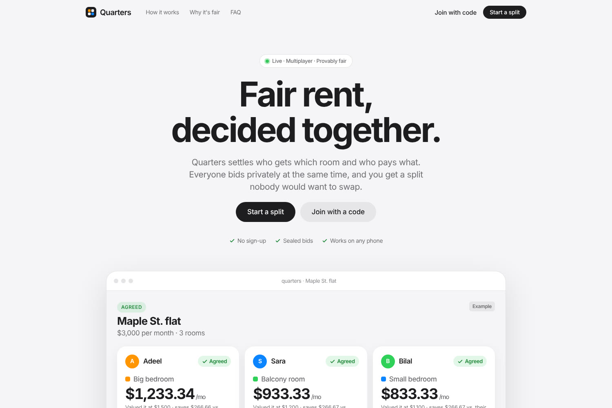
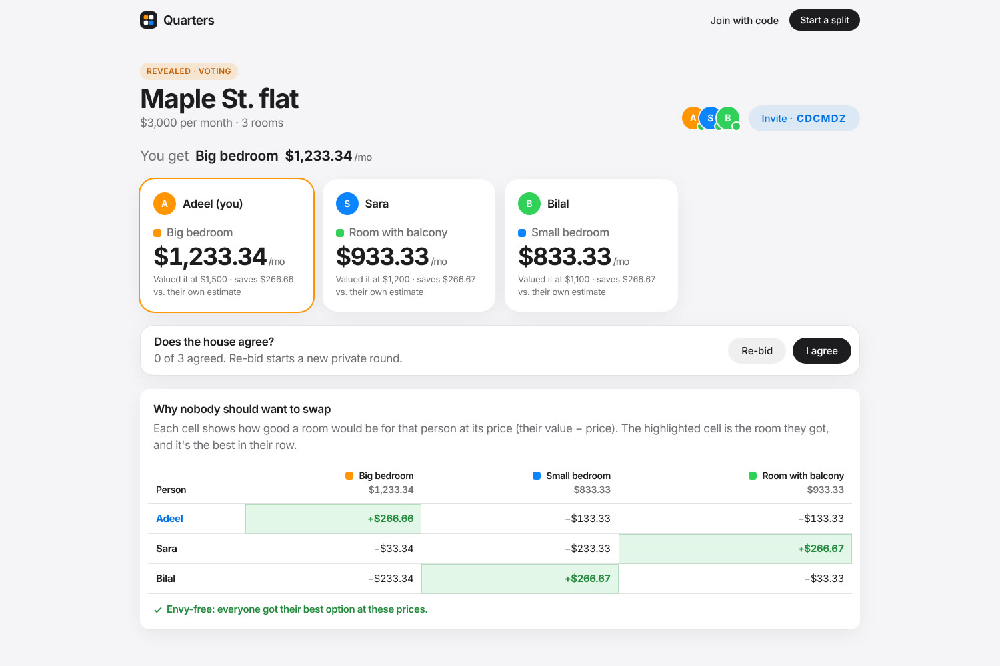
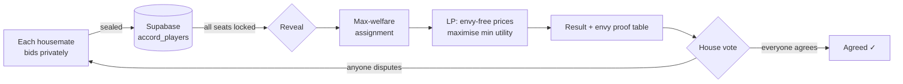
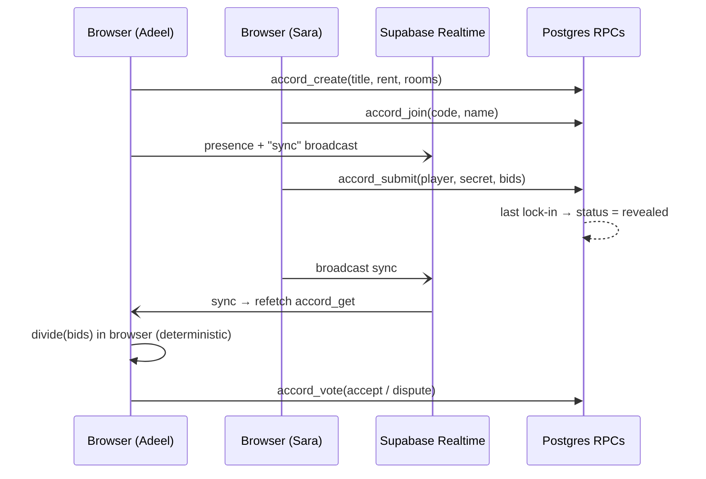

# Quarters — fair rent, decided together

**Live demo:** https://quarters-rent.vercel.app

Moving in with friends means two awkward questions: *who gets the big room*, and *how much more should they pay*? Most groups split rent evenly or just argue. Quarters answers both questions together, in real time.

Everyone opens one link. Each person privately says what every room is worth to them, with bids that add up to the rent. When the last person locks in, Quarters reveals a split that is **envy-free**: at the final prices, nobody would rather have someone else's room. The house then votes. One "re-bid" starts a new private round for everyone.





## Why it's multiplayer at its core

The result only exists once *everyone* has taken part. Live presence shows who's online, who's still bidding and who has locked in. Bids stay sealed on the server until all seats are in, so no one can anchor on anyone else's numbers. The outcome needs everyone's consent through a group vote with a dispute → re-bid loop.

## The math

Quarters implements the *maximin envy-free* rule from Gal, Mash, Procaccia & Zick, ["Which is the Fairest (Rent Division) of Them All?"](https://www.ijcai.org/proceedings/2017/678) (EC 2016 / JACM 2017), which is also the rule behind Spliddit's rent tool.

1. **Assignment.** Rooms go to people so that the total stated value is as large as possible. Any assignment like this can be supported by envy-free prices.
2. **Prices.** Among all room prices that add up to the rent and leave no one envious, a linear program picks the ones that **maximise the minimum utility** (value − price).

`src/fair.ts` runs the assignment by exhaustive search (≤ 8 rooms) and the LP with `javascript-lp-solver`. The "Why nobody should want to swap" table shows the proof to every housemate: each row's highlighted cell is that person's best option.



## Architecture



- **Frontend:** React 19 + Vite + TypeScript, hand-written CSS design tokens with light and dark themes. Hash routing (`#/r/CODE`).
- **Realtime:** Supabase Realtime presence (who's online) and broadcast (state-change pings), with a 6 s polling fallback.
- **Backend:** Postgres on Supabase. Clients can't touch the tables directly (RLS on, no policies). Six `SECURITY DEFINER` functions handle every action:
  - each player gets a random secret, checked on every write
  - bids are hidden until the reveal
  - rent sums and room counts are validated server-side
- **Fairness:** computed client-side from the revealed bids. It's deterministic, so every housemate sees the same result.

## Run locally

```bash
npm install
cp .env.example .env          # add your Supabase URL + publishable key
# apply supabase/migrations/0001_accord.sql to your project (SQL editor or `supabase db push`)
npm run dev
```

## Tests

```bash
npm test            # fairness algorithm: envy-freeness + rent sum on 200 random instances
npx vite preview &  # then:
PW=$(npm root -g)/playwright node e2e/flow.mjs   # 3 browsers: create → join → bid → reveal → re-bid → agree
BASE=https://quarters-rent.vercel.app/ node e2e/flow.mjs   # same, against production
```

## Deploy

Vercel with framework `vite`, build `vite build`, output `dist`. Set `VITE_SUPABASE_URL` and `VITE_SUPABASE_KEY` (the publishable key is public by design; access control lives in the SQL functions).

## Limits

- Assumes quasi-linear preferences (money and rooms trade off linearly) and one person per room.
- Identity is a per-browser secret in localStorage. Clearing it means re-joining as a new seat.
- Up to 8 rooms (brute-force assignment).

## License

MIT
